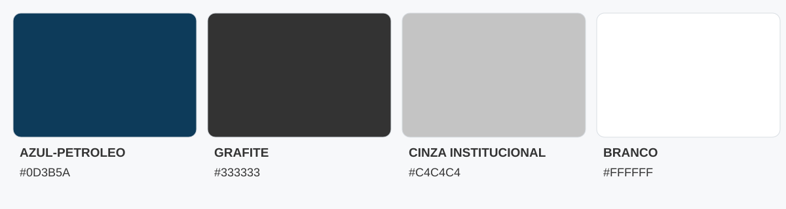

# WME Engenharia — Paleta Oficial de Cores

**Identidade Visual 3.0** · Referência cromática aprovada

| Cor | HEX | RGB (R, G, B) | CMYK (C, M, Y, K) | Aplicação |
|---|---|---|---|---|
| Azul-petróleo | `#0D3B5A` | `13, 59, 90` | `86, 34, 0, 65` | Letra W e elementos de destaque |
| Grafite | `#333333` | `51, 51, 51` | `0, 0, 0, 80` | Letras M e E |
| Cinza institucional | `#C4C4C4` | `196, 196, 196` | `0, 0, 0, 25` | ENGENHARIA e linhas laterais |
| Branco | `#FFFFFF` | `255, 255, 255` | `0, 0, 0, 0` | Fundos e aplicações negativas |

## Diretrizes

- **Digital (web, assinatura de e-mail, redes sociais):** usar os valores RGB/HEX exatos.
- **Impressão:** usar os CMYK como referência, conferindo o resultado com a gráfica conforme perfil de cores, tinta e papel.
- **Branco:** CMYK `0, 0, 0, 0` corresponde à ausência de tinta em papel branco; em outros substratos pode exigir tinta branca especial.
- **Logotipo:** preservar proporções, geometria, espaçamentos e a atribuição de cores de cada elemento.

Documento de referência da identidade visual WME Engenharia 3.0.
